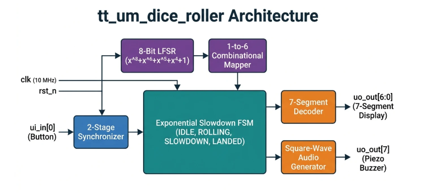
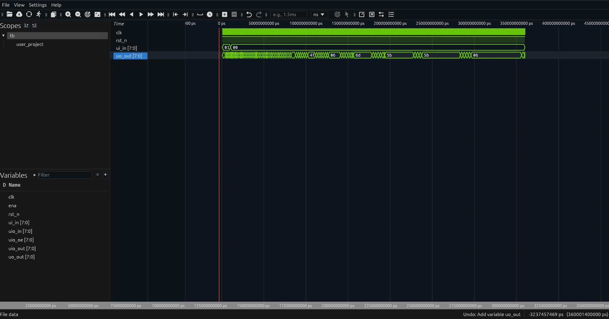

   

# Dice Roller ASIC (`tt_um_dice_roller`)

A custom digital Application-Specific Integrated Circuit (ASIC) written in Verilog for the **Tiny Tapeout GF180MCU** shuttle (GlobalFoundries 180 nm open-source process). Pressing and releasing an external pushbutton rolls a pseudo-random 6-sided die with exponential deceleration—modeling a physical die losing momentum on a table—while driving live digits on a 7-segment LED display and generating chiptune square-wave audio effects on a piezo buzzer.

* **Technical Design Report:** [Read the full write-up & verification analysis](https://docs.google.com/document/d/1Mt7eiRTmFjL-cDM9o5K_2Gxa6C5WE4Lv3SCxppwtxl8/edit?usp=sharing)
* **3D Silicon Layout Viewer:** [Explore the hardened GDSII layout](https://shainadev294-tgr.github.io/dice-roller-asic/)
* **Target Footprint:** Synthesized to fit inside a **340 µm × 160 µm** shared sub-tile allocation on a `1x1` Tiny Tapeout GF180MCU tile.

---

## Architecture & Signal Flow

The design operates synchronously off a **10 MHz** system clock (100 ns period) and uses shift-and-add arithmetic instead of hardware division or multiplication to keep silicon area compact:



1. **2-Stage Input Synchronizer (`sync_0 -> sync_1`):** Passes the asynchronous pushbutton signal (`ui_in[0]`) through two D flip-flops in series to prevent metastability.
2. **8-Bit Maximal-Length LFSR (`x^8 + x^6 + x^5 + x^4 + 1`):** Initialized to seed `8'hA5` on active-low reset (`rst_n = 0`), cycling through 255 pseudo-random states at 10 MHz. The lowest 3 bits (`lfsr[2:0]`, `0–7`) map combinatorially to integers `1–6` (`0 -> 6`, `7 -> 1`) without modulo hardware.
3. **Exponential Slowdown FSM:**
   * `STATE_IDLE (0)`: Holds the resting die value on the display with the buzzer muted (`uo_out[7] = 0`).
   * `STATE_ROLLING (1)`: While `sync_1 == 1`, rapidly cycles die faces and triggers short high-frequency audio blips.
   * `STATE_SLOWDOWN (2)`: Upon button release (`sync_1 == 0`), stretches the interval between face transitions by **25% per step** via shift-and-add (`step_threshold = step_threshold + (step_threshold >> 2)`) while playing pitch-dropping audio blips.
   * `STATE_LANDED (3)`: Once `step_threshold` exceeds the halt limit (~330 ms), plays an ~880 Hz landing chime and locks the final roll onscreen.
4. **7-Segment Decoder & Square-Wave Audio Generator:** Converts the active die value (`1–6`) into active-high 7-segment patterns (`uo_out[6:0]`) and drives a programmable frequency divider on `uo_out[7]` to generate square-wave tones.

---

## Pinout & Hardware Connections

| Pin | Direction | Signal Name | Description |
| :--- | :--- | :--- | :--- |
| `clk` | Input | System Clock | 10 MHz clock supplied by the Tiny Tapeout carrier board |
| `rst_n` | Input | Active-Low Reset | Resets LFSR seed (`8'hA5`), counters, and FSM to `STATE_IDLE` |
| `ui_in[0]` | Input | Roll Button | Active-high pushbutton input (`1` = hold to roll, `0` = release) |
| `uo_out[6:0]` | Output | 7-Segment Display | Active-high segments `g` (`[6]`) through `a` (`[0]`) via 330 Ω resistors |
| `uo_out[7]` | Output | Chiptune Buzzer | Square-wave audio output connected to a passive piezo buzzer |

---

## Verification & Simulation Waveforms

The RTL and gate-level netlist are verified using a Python **Cocotb** testbench (`test/test.py`) that simulates 3.5 million clock cycles (350 ms at 10 MHz) and exports `tb.fst` for inspection in **Surfer**:



* **Roll & Deceleration:** Asserting `ui_in[0]` (`01`) initiates rapid face changes, and releasing it (`00`) produces progressively wider 7-segment states (`06 -> 6d -> 5b -> 5b -> 06`) as `step_threshold` grows exponentially.
* **Audio & Settle:** Square-wave audio bursts appear as dense toggle activity on `uo_out[7]` during each transition and during the final landing chime around 330 ms, after which `uo_out[7]` stays low (`0`) and `uo_out[6:0]` locks onto the final digit (`7d` = `6`).

### Running the Simulation Locally

```bash
cd test
make -B
```

### Inspect the Resulting Waveform Trace
Open test/tb.fst in Surfer or run

```bash
surfer test/tb.fst
```
